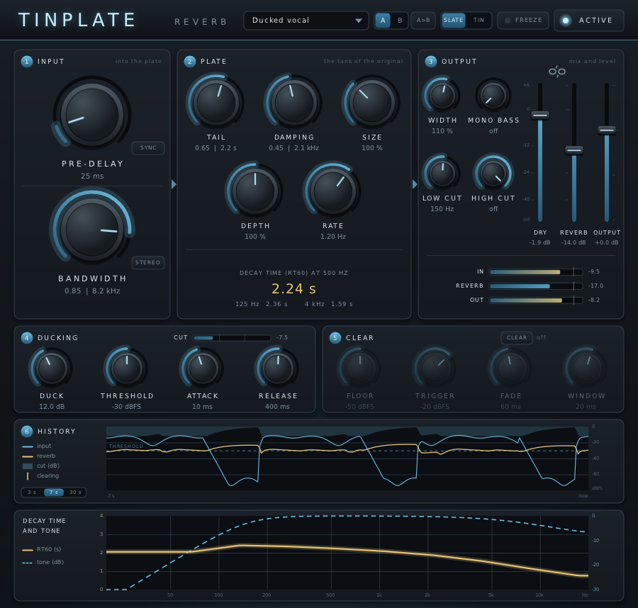
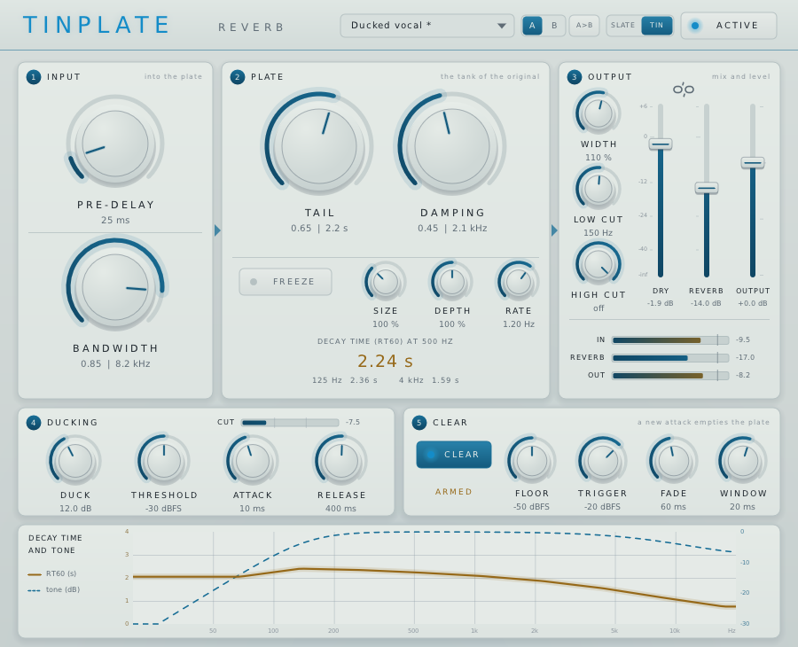

# Tinplate Reverb

Réverbération à plaque, reprise de **`PlateX2`** de CAPS (Tim Goetze, « C* PlateX2 », appelée
**Plate2x2** dans la série 0.4), réécrite en C++ avec DPF, interface NanoVG.
Formats : VST3 et CLAP pour Windows 64 bits ; VST3, CLAP et LV2 pour Linux.
**Licence : GPL 3 ou ultérieure** (`COPYING`), comme CAPS ; DPF est sous ISC (compatible).
Nom provisoire (changer : `DistrhoPluginInfo.h`, `Makefile`, installateur, préférences).

**Manuel d'utilisation** (français, 12 pages : réglages, préréglages, algorithme avec schémas et
figures) : `doc/manuel.pdf` ; source `doc/manuel.tex` (pdflatex ×3 dans `doc/`), figures
`doc/figures.py` (mêmes formules que le DSP, table des RT60 lue dans `plugin/Rt60Table.hpp`,
réponses impulsionnelles calculées par la plaque elle-même via `tools/impulse.cpp`, compilé
dans `build/` par le script).

## Algorithme
Cœur identique à l'original (`plugin/PlateCore.hpp`, transcription de `PlateStub` de CAPS
0.9.26 et des classes `Delay`, `LP1`, `Sine` qu'il emploie ; plaque de Dattorro, JAES 1997) :
- entrée mono (L + R) / 2 → passe-bas « bandwidth » → 4 passe-tout de diffusion ;
- réservoir de deux moitiés croisées : passe-tout modulé (LFO 1,2 Hz, ±17 échantillons à
  44,1 kHz) → retard → passe-bas « damping » → × decay → passe-tout → retard → × decay ;
- sortie : 6 prises par canal, × 0,6.

Les trois réglages de la plaque gardent les plages 0..1 (Tail : 0..1,16 depuis 1.1.0, même loi
au-delà de 1) et les lois de l'original (`TinplateParams.hpp`) :
bandwidth a0 = exp(-π(1 - (0,005 + 0,994 p))), decay = 0,749 p, damping a0 =
exp(-π(0,0005 + 0,9995 p)). Valeurs par défaut : celles qu'un hôte LADSPA donne à PlateX2
(0,5 ; 0,5 ; 0,75). Le Blend de l'original (wet = blend^1,53, dry = 1 - wet) est remplacé en
1.1.0 par deux faders en dB, Dry et Reverb (décision de l'utilisateur). Les mêmes types flottants que
l'original sont employés opération par opération (échantillons en `float`, certaines sommes en
`double`), y compris la constante « normal » de ±1e-20 ajoutée à l'entrée contre les nombres
dénormaux.

**Identité avec l'original** : avec les ajouts au neutre (Pre-delay 0, Low cut off, Width 100 %,
Output 0 dB, Freeze, Duck et Clear off) et Tail ≤ 1, la sortie est **celle de l'original au bit
près** en réverbération seule (Reverb 0 dB, Dry off = Blend 1) et en sec seul (Dry 0 dB, Reverb
off = Blend 0), réglages fixes (test 1 : 32 cas, 7 réglages × 44,1, 48, 96 et 192 kHz, blocs de
tailles variées, en compilation stricte). Mélanges (Blend converti en dB) : écart d'arrondi des
gains, 1,3e-7 de la crête au plus (20 cas) ; options de DPF `-O3 -ffast-math` : < 1e-5. La référence est le code de CAPS lui-même (`tests/caps/`, sources
d'origine non modifiées), appelé par son descripteur LADSPA comme le ferait un hôte.

Chaîne : (L + R + normal) / 2 → Pre-delay → × entrée (Freeze) → plaque → Low cut → Width →
× ducking → wet ; sortie = wet × 10^(Reverb/20) + sec × 10^(Dry/20) → Output → fondu du Bypass
(niveaux à -60 dB : gain 0 ; à 0 dB : exactement 1).
Latence nulle.

Différences voulues avec l'original :
- **lissage** : l'original applique un changement au bloc suivant (bruit de « fermeture éclair »
  sur Tail et Blend : saut de 0,76 sur une sinusoïde de 0,5 quand Blend passe de 0 à 1) ; ici
  chaque coefficient va linéairement à sa nouvelle valeur en 20 ms puis la prend exactement
  (saut 0,025, test 8) ; réglages fixes : aucune différence ;
- **dénormaux** : `run` active aussi FTZ/DAZ et rend à l'hôte son propre état.

## Réglages
| Réglage | Rôle |
|---|---|
| Pre-delay | 0-250 ms avant la plaque ; un changement passe de l'ancien au nouveau retard par un fondu de 30 ms (pas de glissement de hauteur) |
| Bandwidth | passe-bas d'entrée (original) ; affiché : sa fréquence à -3 dB à la fréquence d'échantillonnage courante (« open » s'il reste au-dessus de -3 dB jusqu'à Nyquist) |
| Tail | longueur de la réverbération (original jusqu'à 1 : 5,1 s à 500 Hz) ; jusqu'à 1,16 depuis 1.1.0, même loi (decay 0,869 : 10 s à 500 Hz, Damping au minimum) ; affiché : RT60 à 500 Hz mesuré (voir plus bas) |
| Damping | passe-bas dans la boucle (original) ; affiché : sa fréquence à -3 dB |
| Size | (après `v1.1.0`, point C d'`AMELIORATIONS.md` ; choix 1b, 2a, puis 50-200 %) taille de la plaque, 50-200 % : retards et passe-tout de la boucle, passe-tout modulés et 12 prises × Size, arrondis (diffuseurs d'entrée inchangés) ; gain de boucle non compensé (durée ≈ × Size) ; changement glissé en 100 ms, lectures interpolées pendant le glissement seulement (`PlateCore::Plate::setSize`) ; 100 % : identité au bit (le pointeur de lecture est calculé depuis celui d'écriture, mêmes valeurs) ; mémoire pour 200 % ; Clear : la plaque vide prend la taille aussitôt (`finishGlide`) ; test 14 |
| Freeze | réverbération tenue sans fin : entrée de la plaque fermée, decay à 1, damping supprimé (20 ms), profondeur de modulation à 0 (200 ms) ; le signal sec passe toujours |
| Dry, Reverb | (1.1.0, à la place de Blend) faders des niveaux du sec et de la réverbération seule, off (-60) à +6 dB ; loi de position par morceaux (off, -40, -24, -12, 0, +6 dB à 0, 0,15, 0,35, 0,55, 0,82, 1) |
| Width | largeur stéréo de la réverbération (0 % mono, 200 % côté doublé) |
| Low cut | passe-haut à 12 dB/octave sur la réverbération seule, 20 Hz (off) à 1 kHz, bouton logarithmique |
| High cut | (point A d'`AMELIORATIONS.md`) passe-bas à 12 dB/octave sur la réverbération seule, après Low cut, 1 kHz à 20 kHz (off), logarithmique ; même structure que Low cut (`Cut2`, RBJ en double, contourné à off) ; test 4 (8 kHz : -38 dB pour 1 kHz) |
| Output | gain de toute la sortie, -24..+12 dB (fader depuis 1.1.0) |
| Link | (1.1.0) icône chaîne (liée, dorée) / chaîne brisée au-dessus des faders ; paramètre `link` appliqué par le DSP (l'automation le suit) : gains dry + reverb = 1 (le Blend de l'original), le meneur ≤ 0 dB ; meneur = dernier des deux niveaux reçus par `setParameterValue` (fenêtre ou hôte), Dry quand on lie (`fLinkLeader`, `TinplateLaw::linkedDb`) ; la fenêtre affiche le même calcul et, à la souris, écrit les deux paramètres ; dans les préréglages et A/B (test 13) |
| Bypass | paramètre Bypass déclaré à l'hôte, fondu de 10 ms |
| Duck | (1.1.0) ducking : baisse maximale de la réverbération pendant que l'entrée joue, 0-30 dB (0 = off, défaut) |
| Threshold | seuil du ducking sur la crête de l'entrée, -60..0 dBFS (défaut -30) |
| Attack, Release | constantes de temps du ducking, 1-200 ms (10) et 50-3000 ms (300), boutons logarithmiques |
| Clear | (1.1.0) chaque nouvelle attaque vide la plaque (défaut : éteint) |
| Floor, Trigger, Fade, Window | seuil d'armement -80..-20 dBFS (-50), seuil d'attaque -60..0 dBFS (-20), fondu de l'ancienne plaque 10-500 ms (60, logarithmique), fenêtre de détection 1-200 ms (20, logarithmique) |

**Ducking** (1.1.0, `TinplatePlugin.cpp`, `TinplateDuck::targetDb`) : crête de l'entrée
max(|L|, |R|) avant le Pre-delay ; baisse visée = dépassement du seuil en dB, au plus Duck ;
lissée en dB par un filtre du premier ordre (Attack à la montée, Release à la descente) ; gain
10^(-c/20) sur la réverbération après Width, avant le mélange ; la plaque n'est pas touchée.
Duck 0 et baisse revenue sous 1e-3 dB : gain non appliqué, sortie au bit près sans ducking
(test 11). Sortie `meter_duck` (baisse en dB) pour le vu-mètre CUT. Pas d'entrée latérale
(sidechain externe écarté, décision de l'utilisateur).

**Ordre des paramètres** (`TinplateParams.hpp`) : plaque, Wet, Dry, Pre-delay, Low cut, Width,
Output, ducking, Clear, puis Freeze et Bypass, puis les sorties ; les préréglages (d'usine, de
l'utilisateur, jeux A/B) couvrent `kParamBandwidth` .. `kParamWindow`. Aucune compatibilité avec
1.0.0 (aucun projet 1.0.0, dit l'utilisateur) : ordre et symboles changés librement.

**Clear** (1.1.0, variante « deux plaques », choisie par l'utilisateur ; optionnel, éteint par
défaut) : `fPlate[2]` ; à une attaque, l'autre plaque (vide) devient courante et reçoit l'entrée
dès cet échantillon ; l'ancienne, entrée fermée, s'éteint en Fade ms (demi-cosinus) puis est
vidée (`activate`) et cesse de calculer. Détection : enveloppe de crête de l'entrée avant le
Pre-delay (montée immédiate, descente 30 ms) ; armée sous Floor **et hors fondu** (pas de
réarmement pendant le fondu, demande de l'utilisateur) ; attaque = dépassement de Trigger moins de
Window ms après celui de Floor, sinon désarmée. Rien pendant le gel (son gelé gardé, décision de
l'utilisateur : pas de remplacement du son gelé). Sortie
`meter_clear` (0 attente, 1 armée, 2 vidée, tenu 200 ms). Test 12 : après le fondu, sortie au bit
près celle d'une plaque neuve nourrie depuis l'attaque ; 2e attaque pendant un fondu de 200 ms
ignorée ; rampe de 500 ms et gel : identiques à Clear éteint ; même rampe avec Window 200 ms :
vidée.

Les coefficients des filtres d'origine ne dépendent pas de la fréquence d'échantillonnage (les
retards, si) : à 96 kHz, Bandwidth et Damping coupent deux fois plus haut qu'à 48 kHz, comme dans
l'original ; l'interface affiche les fréquences réelles.

**Freeze sans perte** : avec la modulation, l'interpolation linéaire des retards modulés fait perdre
les aigus pendant le gel (-11 dB à 8 kHz, -16 dB à 16 kHz en 10 s) ; profondeur à 0, les retards
sont entiers et la boucle ne perd rien (niveau à ±0,3 dB sur 20 s de 100 Hz à 16 kHz ; test 6 :
+0,01 dB en 10 s). Les entrées pendant le gel n'ont aucun effet (sortie identique).

**Temps de réverbération affiché** (`plugin/Rt60.hpp`) : **table mesurée** sur la réponse
impulsionnelle (`plugin/Rt60Table.hpp`, écrite par `tools/rt60_table.cpp` : 4 Size (50, 100,
150, 200 %) × 25 Tail de 0 à 1,2 par pas de 0,05 (points de 1.0.0 identiques) × 9 Damping
× 9 octaves de 62,5 Hz à 16 kHz, à 44,1 kHz ; bande RBJ Q = 2, intégrale de Schroeder, pente
-5..-25 dB), interpolée linéairement. Le calcul par le seul gain de boucle (decay⁴ et deux
passages du damping par tour de 0,725 s) donne 20 à 60 % de moins : les passe-tout du réservoir
(coefficients 0,72) résonnent d'eux-mêmes (0,5-0,65 s même à Tail = 0). À une autre fréquence
d'échantillonnage fs, la table est lue à f × 44 100 / fs. Test 7 : valeur affichée = nouvelle
mesure à 10 % près entre les points de la table (15 cas, 44,1 et 96 kHz, dont 3 avec Tail > 1 et
5 à d'autres tailles ; écart maximal 7,6 % ; Tail 1,16 : 9,87 s mesurés, 9,94 s affichés).
Échelle du graphique : 2 à 32 s.

Préréglages d'usine : Default, Original (CAPS), Vocal plate, Drum plate, Ambience, Dark and
long, Bright and wide, Send (100 % wet), Ducked vocal (1.1.0) ; réglés à la lecture des lois, **pas à l'oreille**.
Préréglages de l'utilisateur : comme Brimstone (voir « Interface »).

## Interface
900 × 730 (600 en 1.0.0), redimensionnable (proportions gardées), HiDPI. Trois sections numérotées dans l'ordre
du signal : **1 INPUT** (Pre-delay, Bandwidth), **2 PLATE** (Tail, Damping, Freeze, RT60 à
500 Hz, 125 Hz et 4 kHz ; Tail et Damping grisés pendant le gel), **3 OUTPUT** (Width, Low cut, High cut ;
faders DRY, REVERB, OUTPUT ; vu-mètres IN, REVERB, OUT). Dessous, la bande **4 DUCKING** (Duck, Threshold,
Attack, Release, grisés sauf Duck quand Duck = 0 ; vu-mètre CUT 0-30 dB) et **5 CLEAR** (bouton,
état waiting/ARMED/CLEARED, Floor, Trigger, Fade, Window grisés si éteint). En bas : **temps de
réverbération en fonction de la fréquence** (laiton, secondes, échelle de 2 à 12 s selon la courbe) et **tonalité de la
réverbération** (acier, tirets, dB : Bandwidth et Low cut).

Repris de Brimstone tel quel (même comportement, voir `../brimstone_vst3/LISEZMOI.md`) :
- boutons : glisser verticalement (Maj : fin), molette, double-clic ou Ctrl+clic : défaut,
  clic droit : saisie au clavier ; bulle d'aide sur chaque élément (valeur détaillée dans le
  titre : fréquence à -3 dB, RT60, gains sec et traité en dB) ;
- **préréglages** : liste déroulante (FACTORY puis USER, « Save current settings... »,
  suppression par la croix cliquée deux fois, molette sur la boîte fermée) ; fichiers
  `<nom>.preset` dans `%APPDATA%\Tinplate\presets\` ou `~/.config/tinplate/presets/` (clés :
  symboles des paramètres, `bandwidth`, `tail`, `damping`, `wet`, `dry`, `link`, `predelay`, `lowcut`, `width`,
  `output`, `duck`, `threshold`, `attack`, `release`, `clear`, `floor`, `trigger`, `fade`,
  `window` ; Freeze et Bypass exclus) ;
- **A/B** : deux jeux de réglages, état DPF `ab` enregistré avec le projet ;
- **thèmes** Slate (sombre) et Tin (clair, gris légèrement vert « sage » : gris clairs de 1.0.0
  mêlés à 22 % de (155, 175, 155) ; choisi par l'utilisateur parmi tin, pewter, mist, sage), pastille SLATE | TIN, préférence de l'utilisateur
  dans `tinplate.conf` (`theme=slate|tin`), non enregistrée avec le projet.
Code : `plugin/TinplateUI.cpp`, `TinplatePrefs.hpp`, `TinplateUserPresets.hpp`.

## Compiler
`./build.sh` (Linux, MinGW-w64 `-posix`, git) :
1. clone DPF au commit testé (`4238e1c`) et applique `patches/` (correctif VST3 de Brimstone) ;
2. tests du DSP (deux fois : stricte, options de DPF), des préférences et des préréglages ;
3. Windows → `bin/windows/`, Linux → `bin/linux/` ;
4. installateur Windows (`installer/tinplate.nsi`) si `makensis` est présent
   → `bin/Tinplate-Reverb-1.1.0-setup.exe` (VST3 imposé, CLAP et manuel PDF en option, cochés
   par défaut ; le manuel va dans `Program Files\Tinplate\Tinplate-Reverb-manuel.pdf`, avec un
   raccourci dans le menu Démarrer de tous les utilisateurs). Le PDF n'est pas refait par
   `build.sh` : recompiler `doc/manuel.tex` avant si le manuel a changé.

Installation manuelle sous Windows : copier `bin/windows/tinplate_reverb.vst3` (le dossier entier)
dans `C:\Program Files\Common Files\VST3\`, `tinplate_reverb.clap` dans `...\Common Files\CLAP\`.

Table des RT60 (à refaire si le cœur change) : commandes en tête de `tools/rt60_table.cpp`
(4 min 46 s, un fil par taille, 4 × 25 × 9 réponses de 45 s).

## Vérifications (2026-11-25 ; 1.1.0 le 2026-11-26)
- `tests/test_dsp.cpp` (54 contrôles, deux compilations) : identité au bit avec CAPS (32 cas, plus 20 mélanges à l'arrondi),
  Bypass exact, Pre-delay (réponse décalée d'exactement le retard), Low cut (-40 dB à 50 Hz pour
  500 Hz), Width (0 % : L = R exactement ; 200 % : côté × 2), Freeze (niveau, entrée ignorée,
  décroissance ensuite), RT60 affiché contre mesuré, lissage de Dry/Reverb et du Pre-delay, niveau Dry,
  préréglages, vu-mètres, état A/B, état du FPU rendu ; ducking (test 11 : baisse de 12 dB
  tenue, 6 dB pour 6 dB de dépassement (5,4 mesurés : crête par échantillon), attaque à 63 % en
  10 ms, retour au bit près après la baisse, Duck 0 identique) ; Clear (test 12) ; Link (test 13 : Dry meneur en liant, puis
  automation de Reverb seule, sortie au bit près celle des deux niveaux réglés à la main).
- Test 14 (Size) : passage de 100 à 200 % pendant la lecture sans clic (plus grand saut 0,026
  contre 0,028 à taille fixe) ; RT60 à 500 Hz 2,08 s à 100 %, 4,25 s à 200 %.
- Banc de CPU (`tests/bench_cpu.cpp`, hors `build.sh`, commande en tête du fichier ; point K,
  2026-11-26, `taskset -c 2`) : préréglage Default, 124 ns par trame stéréo à 44,1 kHz (0,55 %
  d'un cœur), 127 ns à 192 kHz (2,4 %) ; silence identique (pas de dénormaux) ; Clear avec
  fondus 40 % du temps, Size en glissement permanent, ducking actif : +20 à +40 % (au plus
  178 ns, 3,4 % d'un cœur à 192 kHz). Mesures à ±10 % (bruit d'une exécution à l'autre).
- `tests/test_prefs.cpp` (7) et `tests/test_user_presets.cpp` (17, sous locale `fr_FR.UTF-8`).
- Validateur VST3 de Steinberg : 47/47 sur le VST3 Linux et sur le VST3 Windows (sous Wine) ;
  1.1.0 : 47/47 sur les deux (script corrigé pour MinGW comme Noise Padifier :
  `CMAKE_TRY_COMPILE_TARGET_TYPE=STATIC_LIBRARY`).
- Installateur (NSIS) : installation et désinstallation silencieuses (`/S`) sous Wine dans un
  préfixe neuf : VST3 identique à `bin/windows/`, CLAP, licence, entrée du registre, puis tout
  retiré.
  Refait avec le manuel (session 68) : PDF installé identique à `doc/manuel.pdf`, raccourci
  dans `ProgramData\...\Start Menu\Programs\Tinplate Reverb\`, puis tout retiré.
- Interface affichée par la version autonome Windows sous Wine, deux thèmes (captures, refaites
  en 1.1.0 avec le préréglage Ducked vocal ; Tin : Clear allumé, bulle d'aide de Clear,
  `-DTINPLATE_UI_DEMO=112 -DTINPLATE_UI_DEMO_CLEAR=1`).
- **Non vérifié** : écoute (aucun réglage n'a été jugé à l'oreille) ; chargement dans un vrai
  logiciel audio ; clics et saisie dans un hôte ; installateur graphique et vrai Windows ;
  sortie identique à un binaire de CAPS distribué (compilé avec `-ffast-math` par un autre
  compilateur : écarts d'arrondi possibles) ; source de la série 0.4 (Plate2x2) non obtenue
  (le site de CAPS renvoie une erreur 500) : d'après le journal de CAPS, les plages des
  commandes ont été ramenées à 0..1 et les lois retouchées depuis (0.9.x).

## Pour reprendre
- Dossier créé en session 68 (2026-11-25) à côté de `brimstone_vst3/`, dont il reprend la
  structure (DPF, `build.sh`, préférences, préréglages, A/B, thèmes, installateur, validateur
  `tools/validate_vst3.sh`). Dépôt git : `master`, distant `origin` = `git@github.com:tterraz/tinplate_reverb.git` (dépôt GitHub
  renommé de `tinplate` en `tinplate_reverb` le 2026-11-25 ; l'ancienne adresse redirige).
- Captures : `CXXFLAGS="-DTINPLATE_UI_DEMO=<zone> -DTINPLATE_UI_DEMO_THEME=<0|1>
  [-DTINPLATE_UI_DEMO_PRESET=<n>] [-DTINPLATE_UI_DEMO_FREEZE=1]"`, version autonome
  (`make -C plugin jack BUILD_DIR_SUFFIX=-demo-<x> DPF_TARGET_DIR=../build-demo-<x>/bin` avec les
  variables MinGW de `build.sh`), lancée sous Wine (`WINEPREFIX` dédié), puis `import -window`
  sur la fenêtre « Tinplate: Tinplate Reverb » (`xwininfo -root -tree`). Zones : knobs 0-7
  (ordre de `kKnobs`), bulles 100 + indice de `kZones`.
- **Release GitHub** (procédure ; `V` = numéro) : `./build.sh` complet sur `master` propre ;
  fichiers assemblés dans `build/release/` (non suivi) : installateur
  `bin/Tinplate-Reverb-V-setup.exe`, `Tinplate-Reverb-V-windows.zip` (VST3, CLAP),
  `Tinplate-Reverb-V-linux-x86_64.tar.gz` (VST3, CLAP, LV2), chacun avec `COPYING` et le manuel, et le
  manuel seul `Tinplate-Reverb-manuel.pdf` ; notes en anglais (`build/release/notes-V.md` :
  nouveautés, téléchargements, installation, essais faits et non faits, licence) ; étiquette annotée
  `vV` (auteur Claude) poussée, puis `/usr/bin/gh release create vV --repo tterraz/tinplate_reverb
  --title ... --notes-file notes-V.md <fichiers>` (`gh` hors du PATH, connecté au compte `tterraz`).
  **Une version publiée** : tout changement livré ensuite demande un nouveau numéro (`getVersion`,
  installateur, documents ; choix de l'utilisateur).
  Le nom du greffon reste provisoire : le changer demande aussi de renommer le dépôt GitHub et de
  refaire une release.
- **1.1.0 (2026-11-26, release GitHub `v1.1.0` publiée, notes `build/release/notes-1.1.0.md`)** : ducking interne (Duck, Threshold, Attack, Release,
  vu-mètre CUT, préréglage Ducked vocal), Tail jusqu'à 1,16 (10 s à 500 Hz) et Clear (vidage à
  chaque attaque, deux plaques) ; fenêtre 900 × 730 ; manuel 15 pages (figure `fig_duck.pdf`). Version 1.1.0 dans `getVersion`,
  l'installateur, `README.md`, le manuel. Reste : écoute du ducking et des longues queues,
  vrai hôte. Release et étiquette `v1.0.0` supprimées de GitHub le 2026-11-26
  (demande de l'utilisateur, aucun utilisateur de 1.0.0) : `v1.1.0` est la seule release.
- Pistes non faites : réglages des préréglages à l'oreille ;
  autres pistes dans `AMELIORATIONS.md`.
