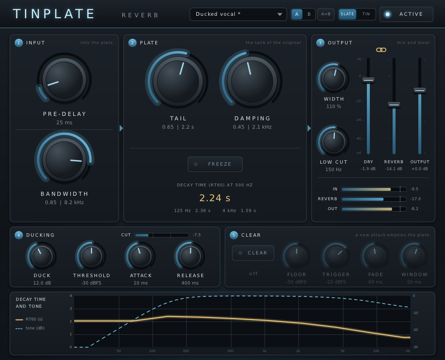
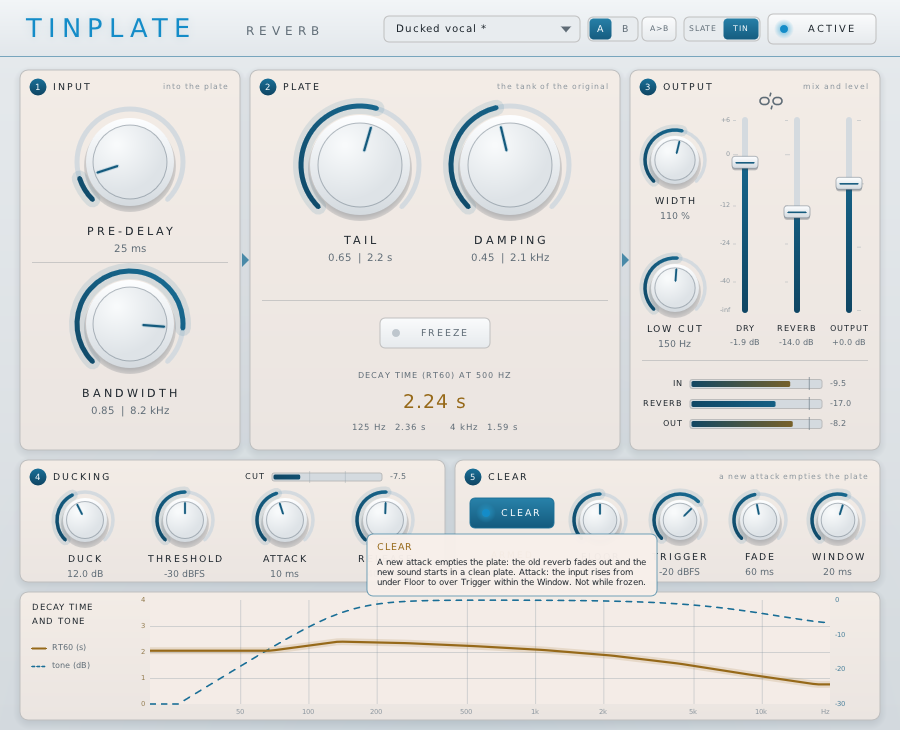

# Tinplate Reverb

A plate reverb for VST3, CLAP and LV2, built around **PlateX2** (formerly **Plate2x2**) of
Tim Goetze's CAPS suite, itself after Jon Dattorro's plate (JAES, 1997), with what a modern
mixing tool needs around it: pre-delay, low cut, width, freeze, ducking, clear on new attacks, tails up to 10 s,
measured decay-time display, presets and A/B comparison.



## Features

- **Original core**: the tank of CAPS PlateX2, transcribed operation by operation. With the
  additions neutral, reverb only or dry only, the output is the original one (blend 1 or 0)
  **to the last bit** (tested against the unmodified CAPS code
  at 44.1, 48, 96 and 192 kHz, strict and `-ffast-math` builds).
- The three plate controls of the original with their ranges and laws: **Bandwidth**, **Tail**,
  **Damping**; shown with their meaning (-3 dB frequencies, decay time).
  **Tail** goes beyond the original range with the same law, up to 10 s at 500 Hz.
- Smooth automation: every coefficient glides in 20 ms (the original jumps at the next block).
- **Pre-delay** (0-250 ms, crossfaded changes), **Low cut** on the reverb (12 dB/octave),
  **Width**; faders for the **Dry** and **Reverb** levels (in place of the Blend of the
  original) and the **Output** gain; a chain icon links Dry and Reverb so that they behave as
  the Blend of the original (raising one lowers the other), in the DSP: host automation
  follows it too.
- **Freeze**: infinite, lossless sustain at every frequency (modulation depth taken to zero).
- **Ducking** (new in 1.1.0): the reverb steps back while the input plays and returns in the
  gaps (Duck depth, Threshold, Attack, Release, cut meter); at Duck 0 the output is exactly the
  one without ducking.
- **Clear** (new in 1.1.0, optional): each new attack after a silence starts in an empty plate
  while the old tail fades out (two plates; Floor, Trigger, Fade, detection Window); off, the
  output is unchanged.
- **Decay time display**: RT60 against frequency from a table measured on the plate's impulse
  response (within 10 % of a new measurement), with the tone of the reverb.
- **Presets**: 9 factory presets and your own (save, replace, delete), shared by all projects.
- **A/B comparison** saved with the project; dark (Slate) and light (Tin) themes; tooltips
  everywhere; keyboard entry of values (right-click a knob); resizable HiDPI interface.
- Bypass declared to the host, zero latency, no denormal slowdown.



## Formats

| Platform | Formats |
|---|---|
| Windows 64-bit | VST3, CLAP (installer included) |
| Linux x86-64 | VST3, CLAP, LV2 |

## Installation

**Windows**: run `Tinplate-Reverb-1.1.0-setup.exe` (VST3, optional CLAP and user manual). Manually: copy the
`tinplate_reverb.vst3` folder to `C:\Program Files\Common Files\VST3\` and
`tinplate_reverb.clap` to `C:\Program Files\Common Files\CLAP\`.

## Documentation

- **User manual** (French): [`doc/manuel.pdf`](doc/manuel.pdf): every setting, the presets and a
  description of the algorithm (signal flow, diagram of the plate, control laws, measured decay
  time, freeze, ducking, bit identity with CAPS), with figures computed from the DSP code
  (`doc/figures.py`; impulse responses by the plate itself through `tools/impulse.cpp`).
- Developer notes (French): [`LISEZMOI.md`](LISEZMOI.md).

## Building

From Linux with MinGW-w64 (`-posix`), git, and optionally NSIS: `./build.sh` clones DPF at the
tested commit, applies `patches/`, runs the tests, and builds Windows and Linux binaries and the
installer into `bin/`.
The manual needs `g++`, `python3-numpy`, `python3-matplotlib` and `pdflatex`:

```sh
cd doc && python3 figures.py && pdflatex manuel.tex && pdflatex manuel.tex && pdflatex manuel.tex
```

## Tests

`tests/test_dsp.cpp` (bit identity with CAPS, bypass, pre-delay, low cut, width, freeze, decay
time, smoothing, presets, meters, ducking, clear), `tests/test_prefs.cpp`, `tests/test_user_presets.cpp`;
Steinberg's VST3 validator passes 47/47 on the Linux and Windows builds.

## Licence

GPL-3.0-or-later (`COPYING`), as CAPS. DPF is ISC-licensed. `tests/caps/` holds unmodified CAPS
0.9.26 sources, used only as the reference of the tests.
